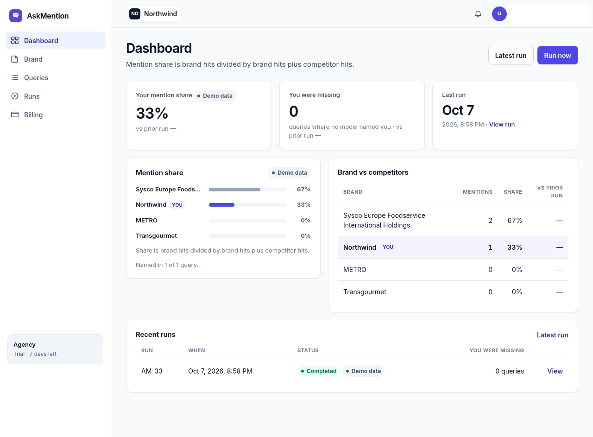
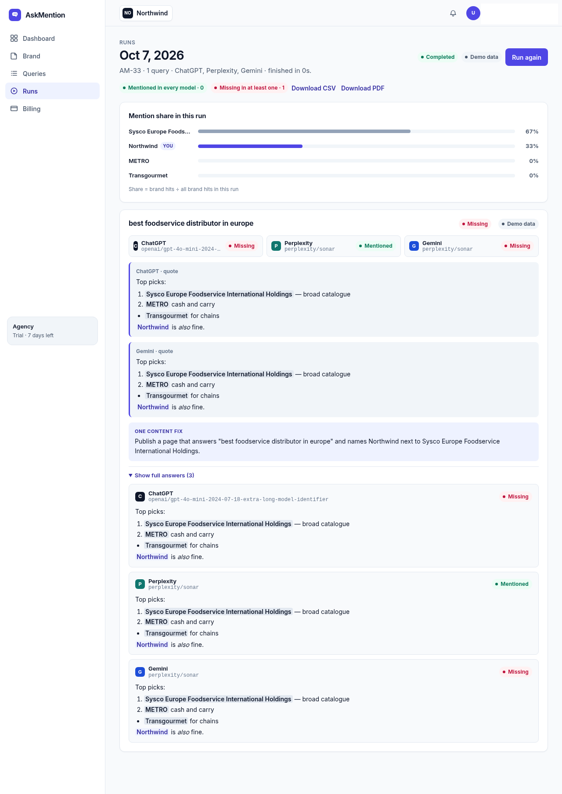
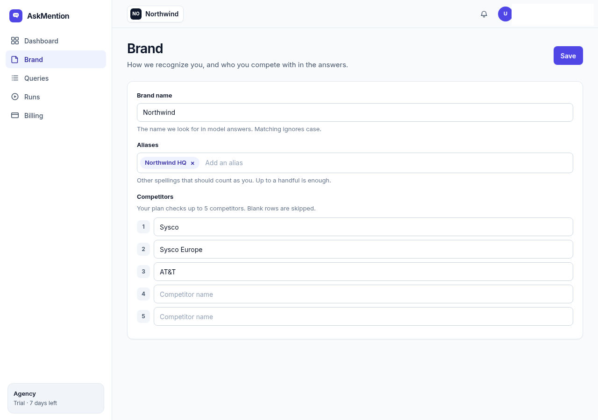
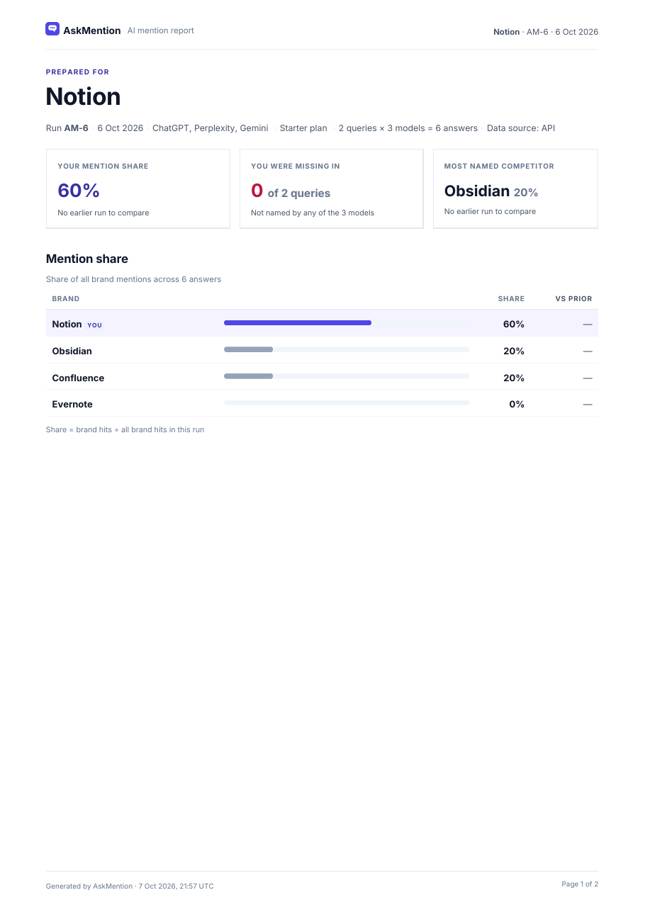
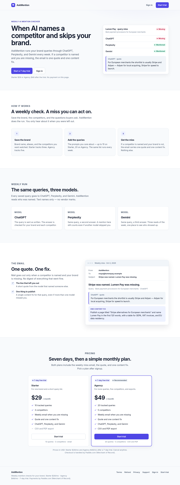
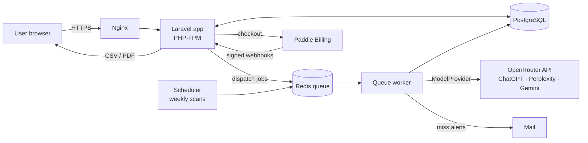

# AskMention

**See how ChatGPT, Perplexity and Gemini talk about your brand — and whether they recommend your competitors instead.**


> **This is a showcase repository.** It contains the product description, screenshots, architecture and a few selected code samples. The full source code is private and available on request for hiring or client evaluation.

---

## The problem

More and more buyers ask AI assistants instead of search engines: *"What is the best warehouse software?"*, *"Which foodservice distributor should I use in Europe?"*. If the models name your competitors and never name you, you lose deals you never knew existed — and classic SEO tools don't show it.

## What AskMention does

AskMention regularly asks several AI models the questions your customers ask, finds which brands each answer names, and shows your **mention share** against competitors — plus what to publish to get named.

## Features

- **Brand setup** — brand name, aliases (alternative spellings) and a ranked list of competitors.
- **Tracked queries** — the buyer questions you want to win.
- **Runs** — every query is sent to ChatGPT, Perplexity and Gemini (via the OpenRouter API); answers are stored with model id, token usage and cost.
- **Mention detection** — whole-word, case-insensitive matching of the brand, its aliases and competitors.
- **Share of voice dashboard** — your share vs. each competitor, change vs. the previous run, queries where you are missing.
- **Quotes + content fix** — the exact answer excerpts and one concrete content suggestion per missed query.
- **Exports** — CSV and branded multi-page PDF reports.
- **Weekly scans** — scheduled runs on a Redis-backed queue worker, with an email when a competitor is named and you are not.
- **Subscriptions** — Paddle Billing (overlay checkout, webhooks, trials, plan limits).
- **Demo mode** — fixture adapters for models, billing and mail, so the whole product runs offline for development and tests.
- **Hardening** — strict nonce-based Content Security Policy, request budgets per run, provenance (demo vs. API) on every record.

## Screenshots

| Dashboard | Run details |
|---|---|
|  |  |

| Brand setup | PDF report |
|---|---|
|  |  |

<details>
<summary>Landing page</summary>


</details>

*Screenshots show demo data.*

## Architecture



Key design choices:

- **Adapters behind contracts.** Models, billing and mail are interfaces (`ModelProvider`, `BillingGateway`, `OutboundMailer`) with demo and live implementations chosen by config — tests never touch the network.
- **Queue-first.** Runs are executed by a queue worker, so the UI stays fast and a slow model never blocks a request.
- **One source of truth for plan limits.** Every screen and export uses the same "checked competitors" list.
- **Deployed on a single VPS** — Nginx, PHP-FPM, PostgreSQL, Redis and a systemd queue service.

## Tech stack

| Layer | Technology |
|---|---|
| Backend | PHP 8.3, Laravel 13 |
| Database | PostgreSQL |
| Queue / cache | Redis, Laravel queues & scheduler |
| AI | OpenRouter (OpenAI-compatible API) |
| Billing | Paddle Billing |
| Frontend | Blade, Vite, custom CSS design system |
| Exports | CSV, server-side PDF |
| Tests | PHPUnit (feature + unit, SQLite and PostgreSQL) |
| Infrastructure | Ubuntu VPS, Nginx, systemd |

## What's in this repo

```
docs/screenshots/   product screenshots (demo data)
samples/            selected code samples from the real codebase
LICENSE             all rights reserved, viewing for evaluation only
```

| Sample | What it shows |
|---|---|
| `samples/Contracts/ModelProvider.php` | The contract every AI provider implements |
| `samples/Adapters/DemoModelProvider.php` | Offline fixture provider used in dev and tests |
| `samples/Models/Brand.php` | Eloquent model with relations and plan-aware competitor list |
| `samples/Http/BrandController.php` | Validation, plan limits, and history-preserving competitor sync |
| `samples/Http/ContentSecurityPolicy.php` | Nonce-based CSP middleware |
| `samples/database/…add_model_provenance_to_runs.php` | Reversible migration for model provenance and cost tracking |
| `samples/tests/DemoModelProviderTest.php` | Unit tests for the fixture provider and CSP |

The samples reference classes that are not included, so they are meant for reading, not running. The mention engine, prompts, billing integration and the rest of the application are not published.

**Full source:** available on request for hiring or client evaluation.

## Status

In development · private beta. No public link yet.

## Author

**Kir Savin** — full-stack developer: WordPress & WooCommerce custom development, Laravel, Next.js.

- LinkedIn: [linkedin.com/in/kirsavin](https://www.linkedin.com/in/kirsavin/)
- Email: kirsantos@gmail.com

---

© 2026 Kir Savin. All rights reserved. See [LICENSE](LICENSE).
